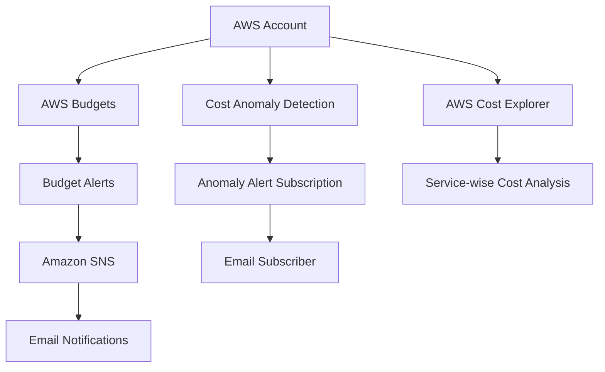

# AWS Cost Monitoring & Budget Alert System

## 📌 Project Overview

This project demonstrates how to monitor AWS spending, configure monthly budgets, receive email notifications, analyze service-wise costs, and detect unusual spending patterns.

The solution uses AWS Budgets, Amazon SNS, AWS Cost Explorer, and AWS Cost Anomaly Detection to improve cost visibility and help prevent unexpected AWS expenses.

## 🎯 Project Objectives

* Configure a monthly AWS spending budget.
* Set up budget alerts at different spending thresholds.
* Deliver notifications through Amazon SNS email subscriptions.
* Analyze AWS costs using Cost Explorer.
* Identify unusual spending patterns using Cost Anomaly Detection.
* Improve cloud cost awareness and financial monitoring.

## 🏗️ Architecture Diagram

## 🛠️ AWS Services Used

| AWS Service                              | Purpose                                                     |
| ---------------------------------------- | ----------------------------------------------------------- |
| AWS Budgets                              | Set a monthly spending limit and configure threshold alerts |
| Amazon SNS                               | Send email notifications through a topic subscription       |
| AWS Cost Explorer                        | Analyze spending and view service-wise cost breakdowns      |
| AWS Cost Anomaly Detection               | Identify unusual changes in AWS spending                    |
| AWS Identity and Access Management (IAM) | Control access to AWS resources and billing information     |

## ⚙️ Implementation Steps

### 1. Configure AWS Budget

Created a monthly budget with the following configuration:

* **Budget Name:** AWS-Monthly-Cost-Budget
* **Budget Type:** Monthly cost budget
* **Budget Amount:** $5
* **Cost Metric:** Unblended cost

Configured actual-cost alert thresholds:

| Alert   | Threshold | Amount |
| ------- | --------: | -----: |
| Alert 1 |       50% |  $2.50 |
| Alert 2 |       80% |  $4.00 |
| Alert 3 |      100% |  $5.00 |

These alerts help monitor spending as it approaches the configured monthly budget.

### 2. Configure Amazon SNS

* Created an SNS topic named `aws-cost-alerts-topic`.
* Created an email subscription.
* Confirmed the email subscription.
* Published a test message from the SNS console.
* Verified that the test notification arrived by email.

### 3. Analyze Costs with AWS Cost Explorer

Used Cost Explorer to review:

* Monthly AWS spending.
* Service-wise cost breakdowns.
* Historical cost information.
* Cost trends across AWS services.

Cost Explorer helps identify which services contribute to AWS expenditure.

### 4. Configure Cost Anomaly Detection

Reviewed the default AWS service cost monitor and configured an anomaly alert subscription.

Cost Anomaly Detection helps identify unusual spending patterns and provides information about potential causes.

### 5. Review Notification Configuration

Reviewed the budget alert thresholds, SNS subscription, and anomaly notification settings.

Budget alerts and anomaly notifications are separate notification mechanisms and should be tested independently.

---

## 📸 Project Screenshots

### 1. AWS Monthly Budget
Displays the monthly AWS budget configuration.

### 2. Budget Alerts
Shows the configured budget alert thresholds.

### 3. Amazon SNS Topic
SNS topic configured to receive AWS cost notifications.

### 4. SNS Email Subscription
Shows the SNS email subscription configuration.

### 5. AWS Cost Explorer
Displays AWS cost information and monthly spending.

### 6. Cost Anomaly Detection Monitor
Shows the monitor used to identify unusual AWS spending.

### 7. Anomaly Alert Subscription
Displays the alert frequency and anomaly notification threshold.

## 🔐 Security and Cost Management Practices

* Use IAM permissions based on the principle of least privilege.
* Avoid exposing AWS account identifiers and personal email addresses in public repositories.
* Monitor AWS spending regularly.
* Review unused AWS resources to reduce unnecessary costs.
* Verify notification subscriptions and alert configurations.
* Set budget thresholds to receive early warnings about increasing expenditure.

## 📚 Key Learnings

Through this project, I gained practical experience with:

* AWS Budgets and spending thresholds.
* Amazon SNS email notifications.
* AWS Cost Explorer.
* AWS Cost Anomaly Detection.
* Cloud cost monitoring and optimization fundamentals.
* AWS console configuration and notification testing.

## 🚀 Future Improvements

* Create a cost monitoring dashboard.
* Add automated cost reports.
* Explore AWS cost optimization recommendations.
* Improve notification testing and monitoring documentation.
* Document IAM permissions and access-control configuration.

## 👨‍💻 Author

**Ankur Khurpadi**

GitHub: [ankurkhurpadi](https://github.com/ankurkhurpadi)

Portfolio: [techankur.cloud](https://techankur.cloud)
