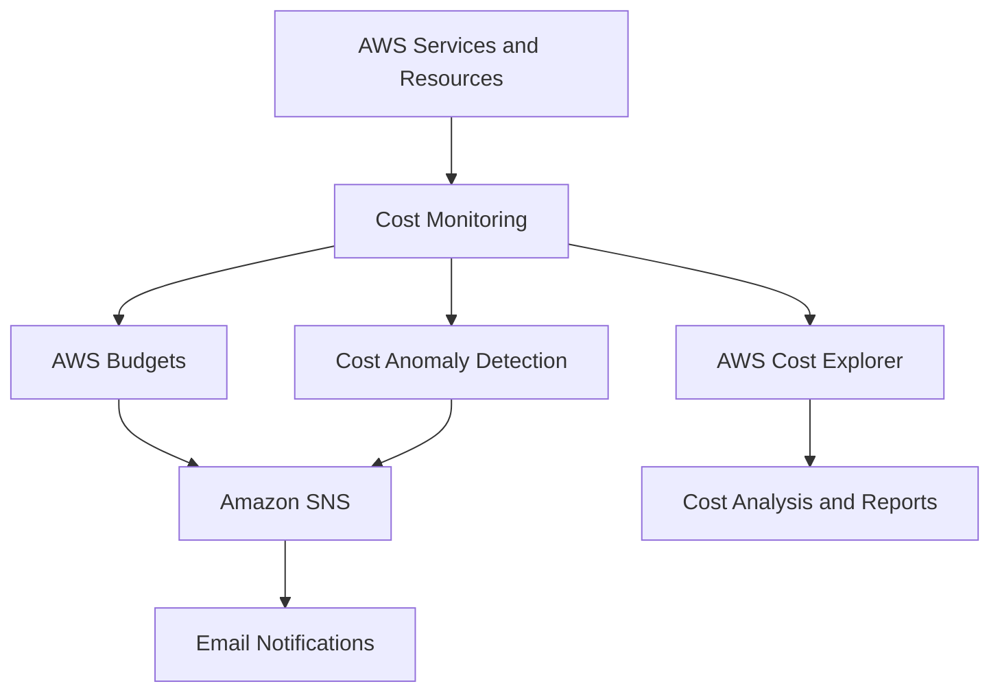
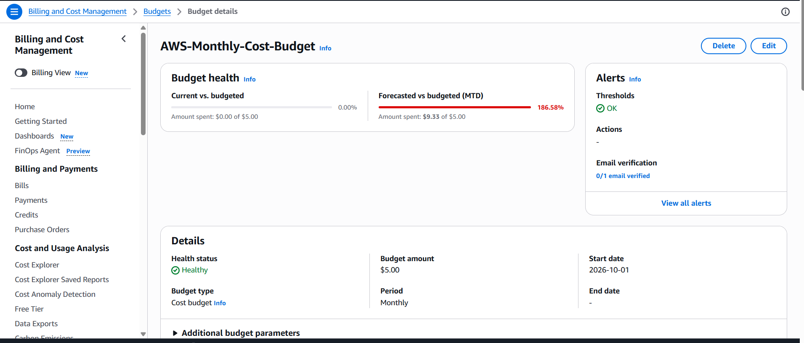
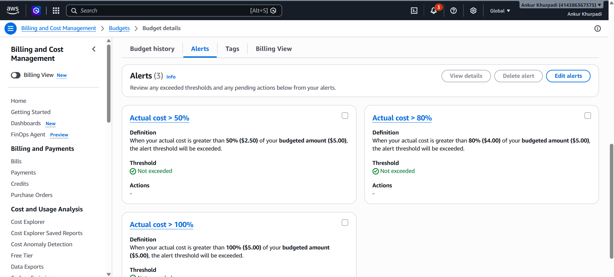
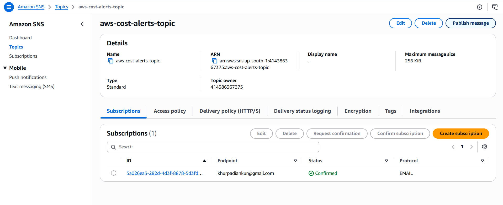
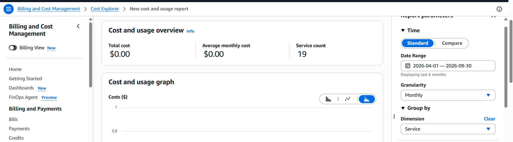
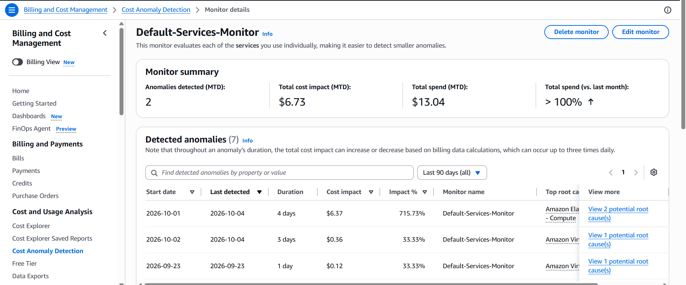
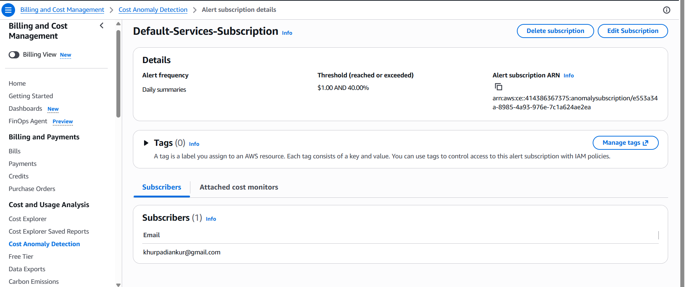

# AWS Cost Monitoring & Budget Alert System

## 📌 Project Overview

This project demonstrates how to monitor AWS spending, configure monthly budgets, receive email notifications, analyze service-wise costs, and detect unusual spending patterns.

The solution uses AWS Budgets, Amazon SNS, AWS Cost Explorer, and AWS Cost Anomaly Detection to improve cost visibility and help identify unexpected AWS expenses.

## 🎯 Project Objectives

- Configure a monthly AWS spending budget.
- Set up budget alerts at different cost thresholds.
- Configure Amazon SNS for email notifications.
- Analyze AWS spending using Cost Explorer.
- Detect unusual spending patterns using Cost Anomaly Detection.
- Improve cloud cost visibility and financial awareness.

## 🏗️ Architecture

## 🛠️ AWS Services Used

| AWS Service | Purpose |
|---|---|
| AWS Budgets | Configure monthly spending limits and budget alerts |
| Amazon SNS | Send email notifications |
| AWS Cost Explorer | Analyze AWS spending and cost trends |
| AWS Cost Anomaly Detection | Detect unusual spending patterns |
| AWS IAM | Manage access to AWS resources |

## ⚙️ Project Implementation

### 1. AWS Budget Configuration

Created a monthly budget named `AWS-Monthly-Cost-Budget`.

- Budget type: Monthly cost budget
- Budget amount: $5
- Scope: All AWS services
- Cost metric: Unblended cost
- Alert thresholds: 50%, 80%, and 100%

### 2. Amazon SNS Configuration

Created an SNS topic named `aws-cost-alerts-topic`.

- Configured an email subscription.
- Confirmed the email subscription.
- Published a test message to verify email delivery.
- Configured SNS as the notification destination for budget alerts.

### 3. AWS Cost Explorer

Used AWS Cost Explorer to review AWS spending information.

- Viewed monthly cost data.
- Explored service-wise costs.
- Reviewed spending trends.

### 4. AWS Cost Anomaly Detection

Used AWS Cost Anomaly Detection to monitor unusual spending patterns.

- Reviewed the existing service monitor.
- Examined detected spending anomalies.
- Reviewed anomaly notification settings.
- Checked alert frequency and threshold configuration.

## 📸 Project Screenshots

The following screenshots demonstrate the AWS project configuration.

### 1. AWS Monthly Budget

### 2. AWS Budget Alerts

### 3. Amazon SNS Topic

### 4. SNS Email Subscription

### 5. AWS Cost Explorer

### 6. Cost Anomaly Detection Monitor

### 7. Cost Anomaly Alert Subscription

## 🔐 Security and Cost Management

- Configured AWS Budgets to monitor spending.
- Used email alerts to improve cost awareness.
- Reviewed AWS spending to identify unexpected costs.
- Used Cost Anomaly Detection to monitor unusual spending.
- Avoided including credentials and sensitive account information in the repository.

## 📚 Key Learnings

- Creating and managing AWS Budgets.
- Configuring Amazon SNS email notifications.
- Analyzing costs using AWS Cost Explorer.
- Monitoring unusual spending with Cost Anomaly Detection.
- Documenting cloud projects using GitHub and Markdown.

## 🚀 Future Improvements

- Develop additional cost reports and visualizations.
- Explore cost forecasting and optimization.
- Improve automated cost monitoring and notification workflows.

## 👨‍💻 Author

**Ankur Khurpadi**

- GitHub: https://github.com/ankurkhurpadi
- Portfolio: https://techankur.cloud